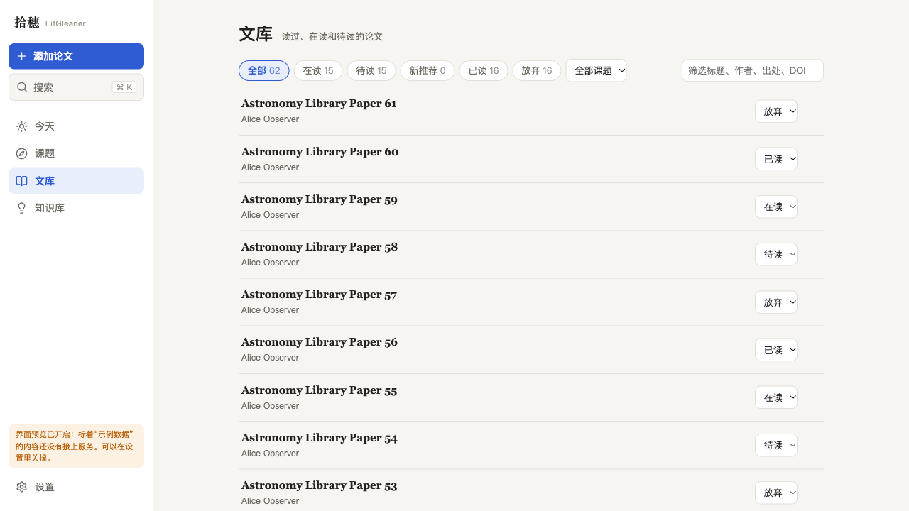
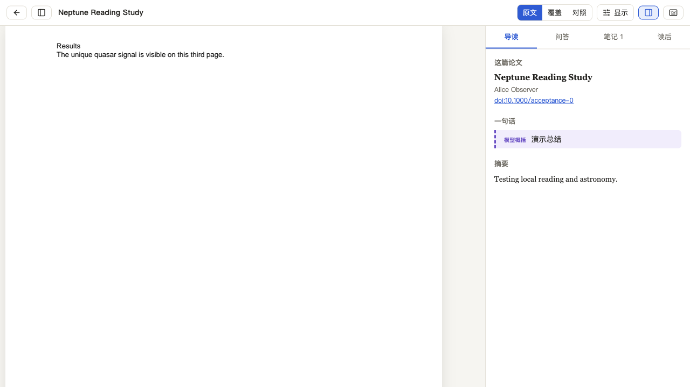
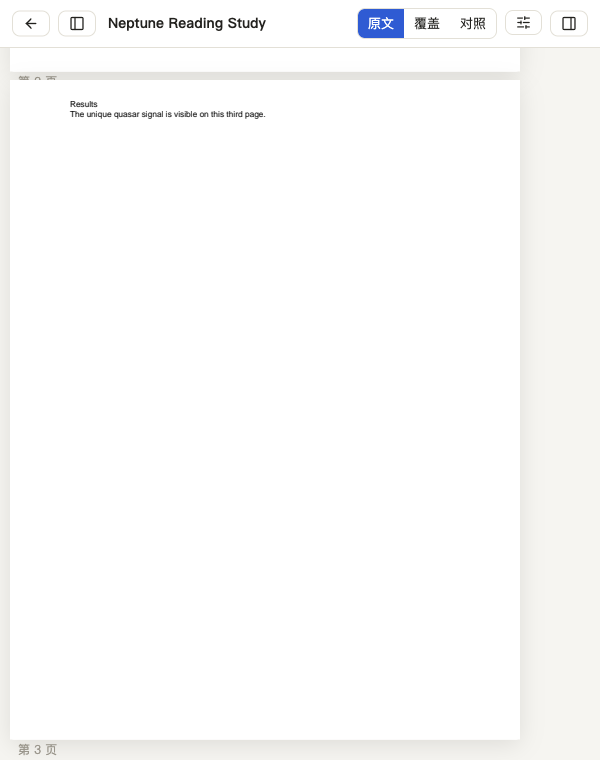

# 文库与全局检索浏览器验收（2026-11-11）

后端使用独立的临时数据库，预置 62 篇论文、真实三页 PDF、逐页解析块、中文笔记和高亮；模型使用假适配器。没有调用真实来源或真实模型，没有改动日常使用的数据。前端由 `pnpm build` 构建，浏览器访问本机常驻服务。

## 已验证

| 场景 | 结果 |
|---|---|
| 1280×720 文库 | 总计 62 篇，首批 50 篇，加载更多后 62/62；已读、放弃各 16 篇，筛选返回的真实状态正确 |
| 中文搜索 | “天文”命中第三页用户笔记，结果标注来源与页码 |
| 全文搜索 | `unique quasar` 命中两篇论文的全文及高亮；相同块编号未出现重复键警告 |
| 搜索后跳页 | 实际滚到 PDF 第三页；同篇论文第三页→第一页→第三页均正确；冷打开 `?page=2` 正确 |
| 600×760 | 文库、搜索和 PDF 可用，没有横向溢出；手动滚回第一页再改变窗口宽度，旧搜索焦点不会重复跳页；再次点搜索结果可以跳页 |
| 浏览器控制台 | 累计 0 错误、0 警告 |
| 前端检查 | `pnpm typecheck`、27 项单元测试、`pnpm build` 通过 |

这次发现 PDF 布局未就绪时的搜索跳页会丢失：地址已经带上页码，页面却仍显示第一页。`PdfView` 改为等待引擎的 `onLayoutReady` 事件后执行定位，复验覆盖冷打开、同篇再次搜索和窗口变化。

## 截图

文库分页：

搜索跳到第三页：

窄屏第三页：

## 范围

没有在 Windows、Safari 上验收；没有重测真实网络添加论文、真实模型翻译或 PDF 中旋转页面的选区坐标。浏览器验收是人工操作和观察，尚未保存为仓库内自动化浏览器测试。
